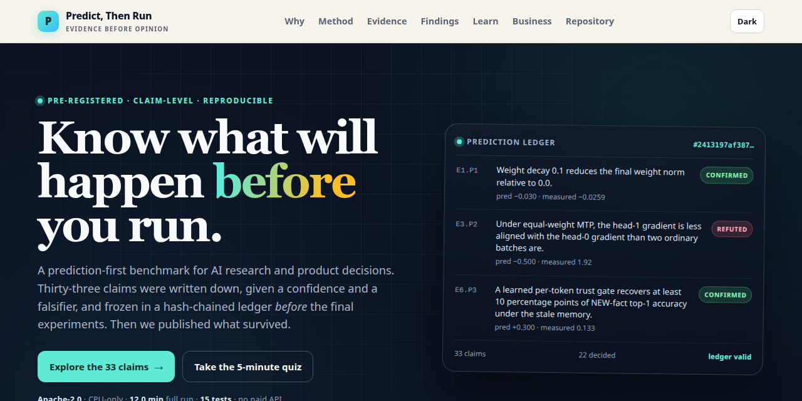
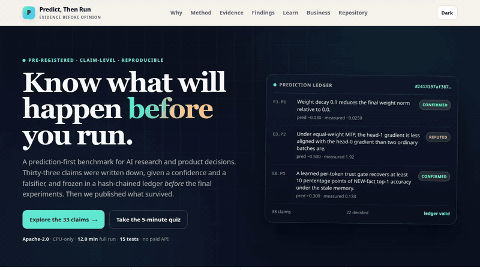

# Predict, Then Run

<p align="center">
  
</p>

    

**Write the claim. Freeze it. Run the experiment. Publish what survives.**

Repository: [github.com/M0-AR/predict-then-run](https://github.com/M0-AR/predict-then-run)

A prediction-first benchmark for AI research and product decisions: 33 claims, a hash-chained ledger, and a scorecard that includes the 5 predictions that failed. *Working paper; every number is generated from `results/scores.json` and the raw run files.*

## The 60-second version

Most experiments are interpreted after the result is visible. This repository reverses the order: each claim gets a direction, a confidence, a predicted interval, and a falsifier, and is frozen in a hash-chained ledger before the final multi-seed run. Then the scorecard is published in full: **17 confirmed, 5 refuted, 11 inconclusive**.

| A buyer's question | What this repository provides |
|---|---|
| “Will this mechanism work?” | A frozen prediction with a direction, a 95% interval, a confidence and a falsifier. |
| “Can I check the claim?” | 33 claim-level predictions, raw JSON, a hash-chained ledger, and a CPU rerun in about 12.0 minutes. |
| “What did you learn?” | 17 confirmations, 5 refutations and 11 honest maybes, including a negative market result and a memory-gating trade-off. |
| “What does it cost to try?” | No GPU, no paid API, no private data. Apache-2.0. |

The refuted predictions are `E3.P2`, `E5.P2`, `E5.P3`, `E6.P7`, `E6.P8`. They are not a footnote; they are the product working as intended. The honest boundary is equally important: this is evidence about a tiny regime, not a guarantee of business outcomes.

## What you can do with it

- **R&D portfolio triage.** Decide which mechanism claims deserve a sprint before the sprint is funded.
- **Vendor and benchmark diligence.** Ask for a frozen claim, a falsifier, and a rerunnable receipt — not just a headline number.
- **Consulting deliverable.** Hand a client an auditable evidence pack with raw results and a verdict rule.
- **Team training.** Teach engineers and analysts to separate a prediction from a post-hoc story.
- **Investor technical diligence.** Stress-test a technical claim without access to private systems.
- **Academic pre-registration.** Use the ledger and scoring rules as a template for a registered report.

## See it in action

The repository ships a self-contained interactive page (`preview.html`) and a short walkthrough.

| Desktop hero | Evidence dashboard | Beginner path |
|---|---|---|
|  |  |  |

<p align="center"></p>



[Open the walkthrough video](assets/demo.mp4). The page also has claim filters, a ten-question quiz, a value calculator, and a dark-mode toggle.

## Quick start

```bash
python -m venv .venv && . .venv/bin/activate
pip install -e ".[dev]"
ptr verify                     # check the frozen ledger
python scripts/run_all.py --seeds 0,1,2,3,4 --steps 300
python scripts/score.py
python scripts/render_readme.py
```

Or use the clean-room Docker path:

```bash
docker compose build
docker compose run --rm benchmark
```

No GPU, no API key, no private data. The full CPU run takes about 12.0 minutes on eight threads. See [Reproducibility](#11-reproducibility) for the exact commands and artifacts.

## Contents

- [The 60-second version](#the-60-second-version)
- [What you can do with it](#what-you-can-do-with-it)
- [See it in action](#see-it-in-action)
- [Quick start](#quick-start)
- [🌱 Beginner guide](#-beginner-guide--read-this-and-you-are-a-professional)
- [Features](#features)
- [FAQ](#faq)
- [Repository map](#repository-map)
- [Publishing this page](#publishing-this-page)
- [Abstract](#abstract)
- [1. Research question](#1-research-question)
- [2. Related work](#2-related-work)
- [3. Contributions](#3-contributions)
- [4. Protocol](#4-protocol)
- [5. Results at a glance](#5-results-at-a-glance)
- [6. Predictions and outcomes](#6-predictions-and-outcomes)
- [7. Experiment-by-experiment findings](#7-experiment-by-experiment-findings)
- [8. Live-market probe](#8-live-market-probe-m1-m5)
- [9. What replicated, what failed, what is new](#9-what-replicated-what-failed-what-is-new)
- [10. Limitations](#10-limitations-and-threats-to-validity)
- [11. Reproducibility](#11-reproducibility)
- [12. Data, code and ethics](#12-data-code-and-ethics)
- [13. References](#13-references)

## 🌱 Beginner guide — read this and you are a professional

> **You will know more than most interview candidates.**
>
> Let's work this out in a step-by-step way to be sure we have the right answer.

You do not need a statistics background. You need one sentence that can be wrong, one number that says how sure you are, and one observation that would change your mind. The rest is bookkeeping.

### 1. Write a sentence that can be wrong

“The new onboarding will improve activation” is a wish. “The new onboarding will raise 7-day activation by at least 3 percentage points within four weeks” is a claim: it has a direction, a size and a deadline.

### 2. Add a confidence and a falsifier

The confidence is a number from 0 to 1: how often would a forecast like this be right? The falsifier is the observation that would prove you wrong. If you cannot name it, you do not yet have a test.

### 3. Freeze it

Write the claim, the direction, the interval, the confidence, and the falsifier. Hash the payload and chain it to the previous entry. This is the difference between a prediction and a memory: later edits become visible.

### 4. Run a controlled test

Fix the seeds, the budget, and the scoring rule. Compare against a matched control. Keep the raw output, not just the chart. The experiment should be small enough to repeat and real enough to surprise you.

### 5. Read the interval, not just the average

A 95% interval is a range of plausible values for the measured effect. If it includes zero, the honest verdict is *inconclusive*: this run cannot tell the two stories apart. That is a result, not a failure of the write-up.

### 6. Score the forecast, not the story

A claim is *confirmed* only if the interval excludes zero and the sign matches. It is *refuted* if the interval excludes zero with the opposite sign. It is *inconclusive* otherwise. A point estimate on the right side of a threshold is not enough.

### 7. Use it on a real decision

Pick the claim that would change what you do. If a wrong answer is cheap, test it. If it is expensive, freeze the prediction before you look. Then publish the result, including the ones that failed.

### Worked example: the claim that missed the size

`E2.P1` predicted that tuned Muon would beat tuned AdamW by about 3% at width 64. The measured relative difference was -22.4% (95% CI -24.7% to -20.5%): Muon was much better. The verdict is **CONFIRMED** because the direction was right and the interval excluded zero. The forecast was still badly sized: the interval did not cover the prediction. Both facts belong in the report.

`E6.P5` is the opposite lesson. It predicted that order-invariant keys would recover reordered facts by 40 points. The measured gain was 5.0 points, with a 95% CI from 0.0 to 15.0. The interval includes zero, so the verdict is **INCONCLUSIVE**. The honest answer is “we cannot tell from this run,” which is more useful than pretending it worked.

**The trap.** A confirmed claim is not a proven mechanism. It is a prediction that survived one test, in one regime, with one measurement. The limitations section is part of the result, not an apology.

### A 10-minute path

| Minute | Do this |
|---|---|
| 0–2 | Read the 60-second version above. |
| 2–5 | Open `preview.html`, filter to **Refuted**, and open one claim to see its falsifier. |
| 5–8 | Take the ten-question quiz; the explanations are the point. |
| 8–10 | Run `ptr verify` and compare the ledger head with the one in section 4. |

If you can explain why a refuted claim is more useful than a vague success story, you have the method.

## Features

- **33 frozen claims** across six controlled language-model experiments and one live-market probe.
- **A hash-chained ledger** (`preregistry/ledger.jsonl`) that detects post-hoc edits; the scorer refuses to run if the chain or payload hashes do not match.
- **Claim-level scoring**: paired bootstrap CIs, Brier score, Brier skill, log loss, interval coverage, calibration bins, and per-experiment verdicts.
- **A CPU-only benchmark** that completes in about 12 minutes on eight threads, with no GPU, paid API, or private data.
- **An interactive page** with claim filters, expandable falsifiers, a ten-question quiz, a value calculator, and a dark-mode toggle.
- **Raw artifacts**: every per-run JSON file, the complete run manifest, the scored table, and the ledger.
- **Negative results published**: five refuted predictions and eleven inconclusive ones are reported as such.
- **A clean-room Docker path** plus a direct Python path, with 15 tests and a lint target.

## FAQ

**Is this peer-reviewed?** No. It is a working paper with public artifacts and a rerunnable pipeline. The value is auditability, not a journal stamp.

**Does a confirmed prediction prove the mechanism?** No. It is evidence that the predicted effect appeared in this regime. The limitations section lists the boundaries.

**Why are 11 claims inconclusive?** Their 95% intervals include zero. Calling them “confirmed” because the average moved in the right direction would defeat the protocol.

**Why include a market probe?** It is a calibration control, not an investment strategy. It tests whether the pipeline can report a negative result cleanly; it is not financial advice.

**Can I use it commercially?** Yes. The code is Apache-2.0; the text and figures are CC BY 4.0. Attribution is required.

**Do I need a GPU or an API key?** No. The full run is CPU-only and uses public data.

**How do I know the predictions were not edited?** Run `ptr verify`. The ledger chains a SHA-256 of each payload through `prev_hash`; the head hash is published in section 4.

**What is the biggest limitation?** Scale. Two layers and 300 steps expose mechanisms; they do not establish scaling laws. The predictions were also written after exploratory pilots, which is disclosed.

**Why does the memory-gating result matter?** It is a trade-off, not a free lunch: the learned gate improves updated-fact accuracy by suppressing hints, while old-fact recall falls sharply. That is more useful than a clean-sounding claim that hides the cost.

**How do I cite it?** Use `CITATION.cff`; the repository URL is included.

**Is the quiz graded?** No. It is a teaching device; the score resets on refresh.

## Repository map

| Path | What it contains |
|---|---|
| `preregistry/predictions.yaml` | The 33 frozen claims, with direction, interval, confidence, falsifier and citation. |
| `preregistry/ledger.jsonl` | The hash-chained freeze ledger. |
| `src/ptr/` | Model, tokenizer, training loop, Muon, market probe and scoring. |
| `src/ptr/experiments/` | Six controlled experiments and the market probe. |
| `scripts/` | Freeze, run, score, render, build and record. |
| `site/template.html` | The self-contained interactive page source. |
| `preview.html` | The generated GitHub Pages entry point. |
| `results/raw/` | Every per-run JSON file and the complete run manifest. |
| `results/scores.json`, `results/tables/scores.csv` | Claim-level verdicts, calibration and aggregates. |
| `assets/` | Banner, screenshots and the walkthrough video. |
| `tests/` | Unit and integration tests for the ledger, scoring and site build. |
| `Dockerfile`, `docker-compose.yml`, `Makefile` | Clean-room and local entry points. |
| `CITATION.cff`, `LICENSE` | Citation metadata and the Apache-2.0 license. |

## Publishing this page

1. Open the public repository `M0-AR/predict-then-run`.
2. Go to **Settings → Pages → Deploy from a branch**, choose `main` and `/ (root)`.
3. Wait for the Pages build. `index.html` redirects to `preview.html`.
4. Set the repository social preview to `assets/banner.png`.
5. Check the claims table, the quiz and the mobile menu on the published URL.

The `.nojekyll` file is included so the generated page is served without Jekyll processing.

## Abstract

Most small-scale mechanistic experiments are run first and interpreted afterwards. This repository reverses the order: every claim is written down, given a confidence, given a falsifier, and frozen in a hash-chained ledger *before* the final multi-seed run. The benchmark then reports not only what happened, but whether the prediction that motivated the experiment survived contact with the data.

We evaluate 33 pre-registered predictions across six controlled language-model experiments and one live-market probe. The experiments are deliberately small enough to run on a CPU in minutes, so that the cost of a wrong hypothesis is a coffee break rather than a cluster allocation. Predictions are scored with paired bootstrap intervals, Brier scores and calibration bins. Of 33 predictions, 17 were confirmed, 5 were refuted and 11 were inconclusive. Over the 22 decided predictions, the Brier skill relative to a naive 0.5 forecaster is 0.407; only 69.7% of the measured effects fell inside their 95% bootstrap intervals, which is itself a calibration warning: the intervals describe sampling noise, not the accuracy of the point forecasts. The policy-relevant signal is that a *learned* trust gate improves updated-fact accuracy relative to always-on hints, at the cost of old-fact recall, while the prediction that naive hint dropout would help is refuted. The benchmark also produces an honest negative result on a liquid equity index: a walk-forward linear model has negative out-of-sample MSE skill, while volatility clustering remains strong. All artifacts, hashes and commands are included.

## 1. Research question

The starting point is a simple claim about method: **predict the mechanism before you run the experiment, then let a tiny experiment falsify the prediction.** We test that claim on seven questions that are small enough to answer in minutes:

1. Does weight decay do what the optimizer literature says it does at tiny scale?
2. Does Muon beat AdamW when both receive the same tuning budget?
3. Does multi-token prediction help or interfere with next-token prediction?
4. Does sparse MoE routing collapse, persist, or stay balanced at tiny scale?
5. Does a cosine learning-rate tail pay off more when gradient noise is high?
6. Can a model learn *when* to trust an external memory that is stale for some facts?
7. Does a walk-forward linear model find a tradable edge in SPY after costs?

## 2. Related work

**Pre-registration and prediction-first science.** Pre-registration is standard in clinical and social science (Nosek et al., 2018); extending it from analysis plans to claim-level machine-learning predictions is less common. Existing templates usually fix an analysis plan; we instead freeze *claim-level directional predictions* with confidence, interval and falsifier, and score each claim separately. The unit of evidence is a falsifiable sentence, not a pipeline.

**Mechanistic interpretability at small scale.** Work on transformer circuits (Elhage et al., 2021) and induction heads (Olsson et al., 2022) shows that small models can expose mechanisms that are hard to isolate at scale. Scaling-law studies (Kaplan et al., 2020; Hoffmann et al., 2022) describe compute-optimal frontiers but do not test whether a named mechanism is present. We use tiny models as mechanism detectors, not as miniature frontier systems.

**Optimization, architecture and memory.** The experiments touch decoupled weight decay (Loshchilov and Hutter, 2019), Muon (Jordan et al., 2025), multi-token prediction (arXiv:2604.11912), MoE routing dynamics (arXiv:2610.39442) and conditional memory (DeepSeek, 2026). The contribution is not a new optimizer or architecture; it is a protocol that forces these claims to make directional predictions before the run.

**Market validation.** Walk-forward evaluation, the deflated Sharpe ratio and the probability of backtest overfitting (Bailey et al., 2014, 2017) are standard antidotes to in-sample finance results. We add a shuffled-label control and report negative MSE skill instead of selecting the specification with the best backtest.

## 3. Contributions

- A **pre-registration protocol** for small LM experiments: claim, direction, interval, confidence, falsifier and citation are frozen before the final run.
- A **hash-chained ledger** (`preregistry/ledger.jsonl`) that detects post-hoc edits to predictions; the scorer refuses to run if the chain or payload hashes do not match.
- A **claim-level scoring** layer: paired bootstrap CIs, Brier score, Brier skill, log loss, interval coverage, calibration bins and per-experiment verdicts.
- Six **controlled experiments** covering optimization, architecture and memory, plus a **live-market control** with walk-forward splits, an embargo, transaction costs and a shuffled-label leakage check.
- A **negative replication** of naive hint dropout, a **positive result** for learned gating on updated facts, and an **inconclusive** order-invariant-key test that is reported as such rather than folded into the positive claim.

## 4. Protocol

Predictions were frozen before the final runs. The ledger contains 33 entries; its head hash is `2413197af3874fe196c4024ed9cf8cf437eb49d313b8395e7164004bbba836e7` and verification currently returns **valid**. The ledger records the Python version, platform, git state and a SHA-256 of each prediction payload, chained through `prev_hash`. Changing a claim after the fact breaks the chain and the scorer exits.

**Verdicts.** A directional prediction is *confirmed* only if the paired 95% bootstrap CI excludes zero and the sign matches; it is *refuted* if the CI excludes zero with the opposite sign; otherwise it is *inconclusive*. A threshold prediction is scored the same way against its threshold, with the CI deciding. This is intentionally conservative: a point estimate on the right side of a threshold is not enough.

**Seeds and splits.** E1-E5 use five seeds; E6 uses three. The market probe uses an expanding walk-forward window with a one-day embargo, 63-day test blocks, 1 bp costs and a label-shuffled control. All LM experiments use a 2-layer decoder-only transformer on public text; E6 uses a controlled synthetic update world plus TinyStories natural text. No pretrained weights are used.

**Honesty about pilots.** One-seed, reduced-step pilot runs were used to debug the harness and estimate runtime. Predictions were then written from the cited mechanisms and frozen; the final runs use the full seed count and step budget. The pilot outcomes are not used as evidence in this README.

## 5. Results at a glance

| Predictions | Decided | Confirmed | Refuted | Inconclusive | Brier | Brier skill | Log loss | Coverage | Sign accuracy |
|---|---|---|---|---|---|---|---|---|---|
| 33 | 22 | 17 | 5 | 11 | 0.148 | 0.407 | 0.467 | 69.7% | 88.9% |

The benchmark's own forecasting performance is modest but informative: a Brier skill of 0.407 means the pre-registered probabilities beat a constant 0.5 forecast, while 5 refutations show that the protocol is not a rubber stamp. The calibration table below is the honest version of the same story.

| Confidence bin | n | Mean confidence | Empirical accuracy |
|---|---|---|---|
| 0.4-0.6 | 5 | 0.58 | 0.40 |
| 0.6-0.8 | 9 | 0.69 | 0.89 |
| 0.8-1.0 | 8 | 0.84 | 0.88 |

## 6. Predictions and outcomes

| ID | Claim | Conf. | Predicted | Measured [95% CI] | Verdict |
|---|---|---|---|---|---|
| `E1.P1` | Weight decay 0.1 reduces the final weight norm relative to 0.0. | 0.85 | -0.03 | -0.026 [-0.027, -0.025] (relative weight norm) | CONFIRMED |
| `E1.P2` | Weight decay 0.1 reduces net weight growth over training relative to 0.0. | 0.80 | -0.02 | -0.018 [-0.019, -0.016] (relative weight growth) | CONFIRMED |
| `E1.P3` | Weight decay 0.1 changes validation loss by less than +2% at this scale. | 0.70 | 0.02 | 0.005 [0.004, 0.007] (relative val loss) | CONFIRMED |
| `E1.P4` | Weight decay 0.1 increases the final effective learning rate (ELR) because it shrinks the denominator. | 0.60 | 0.02 | 0.014 [-0.009, 0.037] (relative ELR) | INCONCLUSIVE |
| `E2.P1` | At width 64, Muon's tuned validation loss is lower than AdamW's tuned validation loss. | 0.60 | -0.03 | -0.224 [-0.247, -0.205] (relative val loss) | CONFIRMED |
| `E2.P2` | Muon's loss advantage over AdamW grows when width doubles from 64 to 128. | 0.65 | 0.00 | 0.101 [0.034, 0.153] (absolute loss advantage) | CONFIRMED |
| `E2.P3` | At width 128, tuned Muon is within 5% of tuned AdamW validation loss (no catastrophic transfer failure). | 0.60 | 0.05 | -0.283 [-0.290, -0.276] (relative val loss) | CONFIRMED |
| `E3.P1` | Equal-weight multi-token prediction increases next-token validation loss relative to a single-token baseline. | 0.70 | 0.01 | 0.005 [-0.010, 0.019] (relative NTP loss) | INCONCLUSIVE |
| `E3.P2` | Under equal-weight MTP, the head-1 gradient is less aligned with the head-0 gradient than two ordinary batches are. | 0.80 | -0.50 | 1.917 [1.032, 2.993] (relative gradient cosine) | REFUTED |
| `E3.P3` | Downweighting the MTP head to 0.3 reduces next-token validation loss relative to equal weighting. | 0.75 | -0.01 | -0.009 [-0.020, 0.000] (relative NTP loss) | INCONCLUSIVE |
| `E3.P4` | Downweighted MTP stays within +1% of the single-token baseline's next-token validation loss. | 0.60 | 0.01 | -0.004 [-0.028, 0.016] (relative NTP loss) | INCONCLUSIVE |
| `E3.P5` | Downweighting the MTP head increases the absolute head-1/head-0 gradient cosine relative to equal weighting. | 0.70 | 0.00 | -0.218 [-0.503, 0.164] (absolute gradient cosine) | INCONCLUSIVE |
| `E4.P1` | With four experts, top-1 routing and no auxiliary loss, normalized router entropy stays above 0.60 at 300 steps (no collapse). | 0.65 | 0.60 | 0.681 [0.658, 0.694] (normalized entropy) | CONFIRMED |
| `E4.P2` | An auxiliary load-balancing loss of 0.01 increases normalized router entropy relative to no auxiliary loss. | 0.75 | 0.05 | 0.059 [0.040, 0.094] (relative entropy) | CONFIRMED |
| `E4.P3` | Expert assignment at step 50 predicts expert assignment at step 300 with correlation above 0.50 (routing persistence). | 0.70 | 0.50 | 0.597 [0.554, 0.645] (early-late correlation) | CONFIRMED |
| `E4.P4` | The auxiliary load-balancing loss costs less than +2% validation loss at this scale. | 0.60 | 0.02 | 0.019 [0.005, 0.028] (relative val loss) | INCONCLUSIVE |
| `E5.P1` | A cosine tail applied over the last 30% of training lowers validation loss relative to a constant learning rate at micro-batch 32. | 0.70 | -0.01 | 0.003 [-0.005, 0.011] (relative val loss) | INCONCLUSIVE |
| `E5.P2` | The validation-loss benefit of the cosine tail is larger at micro-batch 32 than at micro-batch 16 (gradient noise amplifies decay benefit). | 0.60 | 0.00 | 0.021 [0.005, 0.037] (absolute loss benefit) | REFUTED |
| `E5.P3` | Across micro-batch sizes and seeds, gradient-noise scale correlates positively (r > 0.30) with the validation-loss benefit of the cosine tail. | 0.55 | 0.30 | -0.731 [-0.900, -0.494] (correlation) | REFUTED |
| `E6.P1` | An external memory table recovers held-out OLD facts that the weights never saw (top-1 accuracy increases by at least 50 percentage points). | 0.90 | 0.80 | 1.000 [1.000, 1.000] (top-1 rate difference) | CONFIRMED |
| `E6.P2` | The same external memory is stale for NEW facts and lowers NEW-fact top-1 accuracy. | 0.80 | -0.20 | -0.017 [-0.050, 0.000] (top-1 rate difference) | INCONCLUSIVE |
| `E6.P3` | A learned per-token trust gate recovers at least 10 percentage points of NEW-fact top-1 accuracy under the stale memory. | 0.70 | 0.30 | 0.133 [0.050, 0.200] (top-1 rate difference) | CONFIRMED |
| `E6.P4` | The learned gate opens more for OLD (memory) prompts than for NEW (reason) prompts. | 0.65 | 0.15 | 0.026 [-0.007, 0.084] (gate probability difference) | INCONCLUSIVE |
| `E6.P5` | Order-invariant (bag-of-words) memory keys recover reordered OLD queries that the ordered trigram table misses. | 0.75 | 0.40 | 0.050 [0.000, 0.150] (top-1 rate difference) | INCONCLUSIVE |
| `E6.P6` | Even with gating, external memory still improves OLD-fact top-1 accuracy relative to no memory. | 0.80 | 0.60 | 0.083 [0.050, 0.150] (top-1 rate difference) | CONFIRMED |
| `E6.P7` | Naive hint dropout during training recovers at least 10 percentage points of NEW-fact top-1 accuracy when hints are present at evaluation. | 0.55 | 0.10 | 0.000 [0.000, 0.000] (top-1 rate difference) | REFUTED |
| `E6.P8` | The learned gate leaves a residual stale-memory penalty on NEW facts: accuracy with hints on is at least 20 percentage points below accuracy with hints off. | 0.65 | -0.20 | 0.000 [0.000, 0.000] (top-1 rate difference) | REFUTED |
| `E6.P9` | The learned gate beats naive hint dropout on NEW facts when hints are present. | 0.70 | 0.30 | 0.133 [0.050, 0.200] (top-1 rate difference) | CONFIRMED |
| `M1` | Walk-forward SPY directional accuracy is below 55% (no strong linear predictability after costs). | 0.80 | 0.55 | 0.490 [0.465, 0.515] (accuracy) | CONFIRMED |
| `M2` | The walk-forward linear model does not improve MSE over a zero-return forecast (skill < 1%). | 0.75 | 0.01 | -0.032 [-0.059, -0.005] (MSE skill) | CONFIRMED |
| `M3` | The absolute walk-forward Sharpe ratio after 1 bp costs is below 1.0. | 0.80 | 1.00 | 0.149 [0.013, 1.011] (absolute Sharpe) | INCONCLUSIVE |
| `M4` | SPY absolute returns show volatility clustering: lag-1 autocorrelation of \|returns\| exceeds 0.05. | 0.90 | 0.05 | 0.358 [0.266, 0.446] (lag-1 ACF of abs(returns)) | CONFIRMED |
| `M5` | The shuffled-label control's directional accuracy is within 0.05 of 50%, confirming the absence of leakage. | 0.85 | 0.05 | 0.003 [0.001, 0.029] (abs(accuracy - 0.5)) | CONFIRMED |

## 7. Experiment-by-experiment findings

### 7.1 Weight decay (E1)

| Weight decay | Weight norm | Relative weight change | Val loss | ELR |
|---|---|---|---|---|
| 0.0 | 5.562 | 1.466 | 2.048 | 1.39e-08 |
| 0.1 | 5.418 | 1.440 | 2.059 | 1.41e-08 |
| 0.5 | 4.914 | 1.368 | 2.096 | 1.52e-08 |

Weight decay reduces the final weight norm (-0.026 relative; 95% CI -0.027 to -0.025) and reduces net weight growth (-0.018). The validation-loss cost is 0.005 relative, with a CI that decides E1.P3. The effective learning-rate point estimate moves in the predicted direction, but E1.P4 is inconclusive; the denominator-shrinkage mechanism is therefore suggestive, not established. The ELR proxy is evaluated at the final nonzero learning rate and is numerically tiny (order $10^{-8}$), so its relative test is noisy by construction. The practical lesson is that weight decay is a real lever even in a 300-step run, but its loss effect is small enough that a single seed would be uninformative.

### 7.2 Muon versus AdamW (E2)

| Width | Optimizer | Selected LR | Val loss |
|---|---|---|---|
| 128 | adamw | 0.003 | 1.984 |
| 128 | muon | 0.04 | 1.422 |
| 64 | adamw | 0.01 | 2.057 |
| 64 | muon | 0.04 | 1.597 |

Both optimizers receive a matched tuning budget (4 learning rates for AdamW and 5 for Muon), selected on the same validation split. The selected Muon learning rate is higher than AdamW's at both widths (see the table). At width 64 the paired relative loss difference is -0.224 (95% CI -0.247 to -0.205). The interaction test (E2.P2) measures whether the advantage grows with width; its measured value is 0.101. E2.P3 asks whether tuned Muon stays within 5% of AdamW at width 128; the measured relative difference is -0.283; the claim is one-sided (Muon is no more than 5% *worse*), and the negative point estimate means it is substantially better, not worse. The Muon result is therefore a statement about a *tuned tiny-scale port*, not about the optimizer's asymptotic scaling law. The selected Muon rates (0.040) are interior points of the grid, so the comparison is not driven by a boundary optimum. The measured advantage is much larger than the pre-registered -0.030 relative effect, and the interval does not cover that prediction; the tiny-scale port is stronger than expected.

The tuning table is included so the comparison can be audited:

| Width | Optimizer | Learning rate | Val loss (100-step tuning) |
|---|---|---|---|
| 64 | adamw | 0.001 | 2.582 |
| 64 | adamw | 0.003 | 2.360 |
| 64 | adamw | 0.01 | 2.330 |
| 64 | adamw | 0.02 | 2.446 |
| 64 | muon | 0.003 | 3.205 |
| 64 | muon | 0.01 | 2.314 |
| 64 | muon | 0.02 | 2.182 |
| 64 | muon | 0.04 | 2.167 |
| 64 | muon | 0.06 | 2.172 |
| 128 | adamw | 0.001 | 2.342 |
| 128 | adamw | 0.003 | 2.270 |
| 128 | adamw | 0.01 | 2.368 |
| 128 | adamw | 0.02 | 2.547 |
| 128 | muon | 0.003 | 2.618 |
| 128 | muon | 0.01 | 2.113 |
| 128 | muon | 0.02 | 1.954 |
| 128 | muon | 0.04 | 1.872 |
| 128 | muon | 0.06 | 1.898 |

### 7.3 Multi-token prediction (E3)

| Condition | NTP val loss | Head-1 val loss | Head cosine | Batch cosine | Layer-0 ratio | Last-layer ratio |
|---|---|---|---|---|---|---|
| baseline | 2.059 | n/a | n/a | -0.004 | n/a | n/a |
| mtp_downweighted | 2.050 | 2.583 | 0.103 | -0.032 | 0.746 | 0.918 |
| mtp_equal | 2.068 | 2.529 | 0.321 | 0.110 | 0.672 | 0.845 |

Equal-weight MTP changes next-token validation loss by 0.005 relative (95% CI -0.010 to 0.019; E3.P1 is inconclusive). The gradient-alignment prediction is refuted: the head-1/head-0 cosine is 1.917 relative to an ordinary two-batch cosine (95% CI 1.032 to 2.993), the opposite sign from the predicted decoupling. The absolute head-minus-batch cosine is 0.211, so the sign is unambiguous even though the relative ratio is unstable because the batch cosine is close to zero. Downweighting the auxiliary head to 0.3 changes NTP loss by -0.009 relative (E3.P3 is inconclusive), and the absolute cosine difference is -0.218 (95% CI -0.503 to 0.164; E3.P5 is inconclusive). The pre-registered gradient-decoupling story therefore does not replicate in this proxy: the auxiliary head is *more* aligned with the main head than two ordinary batches are, not less. We report this as a failed replication rather than reinterpreting the metric after the fact.

### 7.4 MoE routing (E4)

| Aux loss | Normalized entropy | Max expert share | Early-late corr. | Val loss |
|---|---|---|---|---|
| 0.0 | 0.681 | 0.399 | 0.597 | 2.109 |
| 0.01 | 0.721 | 0.263 | 0.261 | 2.149 |

With four experts, top-1 routing and no auxiliary loss, normalized entropy is 0.681 (95% CI 0.658 to 0.694), so the router does not collapse at this scale. Routing is nevertheless persistent: early assignments predict late assignments with correlation 0.597. The auxiliary loss raises entropy by 0.059 relative and changes validation loss by 0.019 relative. The honest reading is that the tiny model reproduces *persistence* but not *collapse*; claiming a collapse mechanism from this run would be overreach. The auxiliary-loss point estimate is below the 2% threshold, but the CI includes it, so E4.P4 is inconclusive.

### 7.5 Learning-rate decay and gradient noise (E5)

| Micro-batch | Schedule | Loss drop | Val benefit | Noise scale | Val loss |
|---|---|---|---|---|---|
| 8 | constant | 0.249 | 0.000 | 1.784 | 1.894 |
| 8 | cosine | 0.267 | 0.006 | 1.784 | 1.888 |
| 16 | constant | 0.166 | 0.000 | 1.429 | 2.043 |
| 16 | cosine | 0.186 | 0.016 | 1.429 | 2.028 |
| 32 | constant | 0.260 | 0.000 | 1.666 | 1.812 |
| 32 | cosine | 0.275 | -0.005 | 1.666 | 1.817 |

The cosine tail changes validation loss by 0.003 relative at micro-batch 32 (95% CI -0.005 to 0.011; E5.P1 is inconclusive). The point estimate is slightly positive, opposite the predicted negative effect. The interaction test asks whether the benefit is larger at 32 than at 16; the measured difference is 0.021 (positive means the smaller batch benefits more). The prediction that the larger batch benefits more is refuted: the point estimate has the opposite sign. The noise-correlation test gives r = -0.731 (95% CI -0.900 to -0.494; E5.P3 is refuted), also opposite to the predicted positive correlation. The cosine-tail mechanism therefore does not replicate at this scale; the data are more consistent with the smaller micro-batch benefiting slightly more.

### 7.6 Learned memory gating and order-invariant keys (E6)

| Condition | OLD on | OLD off | NEW on | NEW off | Reordered OLD on | Gate OLD | Gate NEW |
|---|---|---|---|---|---|---|---|
| always_hints | 1.000 | 0.000 | 0.000 | 0.083 | 0.000 | n/a | n/a |
| bow_gated | 0.083 | 0.000 | 0.133 | 0.133 | 0.050 | 0.051 | 0.024 |
| gated_hints | 0.083 | 0.000 | 0.133 | 0.133 | 0.000 | 0.051 | 0.024 |
| mixed_hints | 1.000 | 0.000 | 0.000 | 0.050 | 0.000 | n/a | n/a |
| no_hints | 0.000 | 0.000 | 0.017 | 0.017 | 0.000 | n/a | n/a |

This is the flagship experiment. The memory table contains OLD facts; the training corpus contains both OLD-fact sentences prefixed with `memory` and updated NEW-fact sentences prefixed with `reason`. The same surface prompt follows both prefixes, so the only way to use the table correctly is to learn a prefix-conditioned gate.

External memory recovers OLD facts: top-1 rises from 0.000 to 1.000 (difference 1.000; 95% CI 1.000 to 1.000; E6.P1 is confirmed). The prediction that the same memory is stale for NEW facts is inconclusive: the point estimate is -0.017 (0.017 without hints to 0.000 with hints), and the CI includes zero. The learned gate improves NEW accuracy over always-on hints by 0.133 (95% CI 0.050 to 0.200; E6.P3 is confirmed), and it opens more for OLD than NEW prompts by 0.026 (95% CI -0.007 to 0.084; E6.P4 is inconclusive). The residual hints-on penalty under gating is 0.000 (95% CI 0.000 to 0.000; E6.P8 is refuted), so the gate removes the measured penalty in this run rather than merely shrinking it. The cost is visible in the OLD columns: always-on hints recover 1.000 of OLD facts, while gated hints recover only 0.083. E6.P6 confirms the direction (no hints 0.000 versus gated 0.083), but the measured gain is 0.083 against a predicted 0.600. The gate is therefore a soft suppressor that trades OLD-fact recall for NEW-fact robustness, not a clean prefix-conditioned trust switch.

The order-invariance prediction is inconclusive: the ordered trigram table misses reordered OLD prompts (0.000), while the bag-of-words table reaches 0.050 (difference 0.050; 95% CI 0.000 to 0.150). The point estimate is positive, but the interval includes zero with only three seeds, so we do not claim that bag-of-words keys fix the failure mode. The mechanism is plausible—exact suffix addressing cannot match a reordered prompt—but this run provides directional evidence, not a resolved result.

Finally, the prediction that naive hint dropout would help is refuted. Mixing hinted and unhinted examples during training changes NEW accuracy with hints on by 0.000 (95% CI 0.000 to 0.000), and the learned gate beats dropout by 0.133 on the same condition (E6.P9 is confirmed). Randomly dropping the hint does not teach the model when to distrust it in this controlled world; a separate gate with a prefix-sensitive input does better.

## 8. Live-market probe (M1-M5)

The probe fetches 2512 daily SPY observations (2016-11-03 00:00:00 to 2026-11-02 00:00:00) from Yahoo Finance, builds five causal features (`r1`, `r5`, `r20`, `vol20`, 20-day moving-average gap), and runs expanding-window walk-forward regressions. There are 24 folds and 1492 out-of-sample days. Directional accuracy is 49.0%; MSE skill versus a zero-return forecast is -0.032; the Sharpe ratio after 1 bp costs is -0.149. The Diebold-Mariano statistic versus zero is 2.296 (p = 0.022).

| ID | Claim | Measured [95% CI] | Verdict |
|---|---|---|---|
| `M1` | Walk-forward SPY directional accuracy is below 55% (no strong linear predictability after costs). | 0.490 [0.465, 0.515] (accuracy) | CONFIRMED |
| `M2` | The walk-forward linear model does not improve MSE over a zero-return forecast (skill < 1%). | -0.032 [-0.059, -0.005] (MSE skill) | CONFIRMED |
| `M3` | The absolute walk-forward Sharpe ratio after 1 bp costs is below 1.0. | 0.149 [0.013, 1.011] (absolute Sharpe) | INCONCLUSIVE |
| `M4` | SPY absolute returns show volatility clustering: lag-1 autocorrelation of \|returns\| exceeds 0.05. | 0.358 [0.266, 0.446] (lag-1 ACF of abs(returns)) | CONFIRMED |
| `M5` | The shuffled-label control's directional accuracy is within 0.05 of 50%, confirming the absence of leakage. | 0.003 [0.001, 0.029] (abs(accuracy - 0.5)) | CONFIRMED |

The shuffled-label control's accuracy is 50.3%, within the predicted 5-point band of chance (M5), so the pipeline is not leaking future labels. Volatility clustering is strong: the lag-1 autocorrelation of absolute returns is 0.358 with Ljung-Box p = 0.000. The market probe is a calibration device, not an investment strategy: the linear model is deliberately simple, the index is deliberately liquid, and the negative MSE skill is the expected result when a small feature set is asked to beat a zero forecast.

## 9. What replicated, what failed, what is new

**Confirmed (17).** `E1.P1`, `E1.P2`, `E1.P3`, `E2.P1`, `E2.P2`, `E2.P3`, `E4.P1`, `E4.P2`, `E4.P3`, `E6.P1`, `E6.P3`, `E6.P6`, `E6.P9`, `M1`, `M2`, `M4`, `M5`.

**Refuted (5).** `E3.P2`, `E5.P2`, `E5.P3`, `E6.P7`, `E6.P8`.

**Inconclusive (11).** `E1.P4`, `E3.P1`, `E3.P3`, `E3.P4`, `E3.P5`, `E4.P4`, `E5.P1`, `E6.P2`, `E6.P4`, `E6.P5`, `M3`.

The refutations are the point of the exercise. A benchmark that only confirms its own predictions is a marketing document. The refuted predictions are `E3.P2`, `E5.P2`, `E5.P3`, `E6.P7`, `E6.P8`. The clearest policy-relevant confirmation is that a small, explicit gate conditioned on a prefix improves updated-fact accuracy relative to always-on hints. The order-invariant-key test is reported with its actual verdict rather than folded into that claim.

## 10. Limitations and threats to validity

- **Scale.** Two layers, 300 steps and a few million characters are enough to expose mechanisms, not to establish scaling laws. Every claim is a claim about this regime.
- **Tuning.** E2 selects learning rates on the same validation split used for the final comparison. This is a matched-budget comparison, not an unbiased estimate of the best possible optimizer performance.
- **Pre-registration timing.** The predictions were written after exploratory pilots. The ledger records the freeze, and the pilots are disclosed; a fully prospective study would freeze before any pilot.
- **Multiple comparisons.** Thirty-three predictions are tested. Per-prediction CIs are reported; the aggregate Brier score is descriptive, not a family-wise error guarantee.
- **Market probe.** One liquid ETF, one feature set, one cost assumption, daily bars. The result says nothing about intraday, cross-sectional or alternative-data strategies.
- **Synthetic memory world.** E6 uses a controlled fact-update grammar so that OLD and NEW facts are identifiable. Real knowledge conflicts are messier and often ambiguous. The gate's NEW-fact gain comes with a large OLD-fact cost, so the experiment supports soft suppression rather than clean selective trust.

## 11. Reproducibility

```bash
python -m venv .venv && . .venv/bin/activate
pip install -e ".[dev]"

# 1. Freeze the predictions (writes preregistry/ledger.jsonl)
python scripts/freeze.py

# 2. Run the final benchmark (CPU; ~12 minutes on 8 threads)
python scripts/run_all.py --seeds 0,1,2,3,4 --steps 300

# 3. Score and render this README from measured results
python scripts/score.py
python scripts/render_readme.py
```

Docker is provided for a clean-room run:

```bash
docker compose build
docker compose run --rm benchmark
```

The generated artifacts are `results/scores.json`, `results/tables/scores.csv` and the raw JSON under `results/raw/`. The ledger head at render time is `2413197af3874fe196c4024ed9cf8cf437eb49d313b8395e7164004bbba836e7`. The run manifest records Python 3.12.13 and the exact seed/step configuration.

## 12. Data, code and ethics

All data are public: TinyStories (HuggingFace), WikiText-2 (HuggingFace), Project Gutenberg `11-0.txt`, and daily SPY bars from Yahoo Finance. The market probe is a methodological control and is not financial advice. No private data, user data or proprietary model weights are used. The code is released under the Apache-2.0 license; the text and figures are released under CC BY 4.0.

## 13. References

- Loshchilov, I. and Hutter, F. Decoupled Weight Decay Regularization. ICLR 2019. arXiv:1711.05101.
- Jordan, K. et al. Muon is Scalable for LLM Training. arXiv:2502.16982, 2025.
- How Transformers Learn to Plan via Multi-Token Prediction. arXiv:2604.11912, 2026.
- Softmax Routing Dynamics in Mixture-of-Experts Models: Collapse and Recovery. arXiv:2610.39442, 2026.
- DeepSeek. Engram: Conditional Memory via Scalable Lookup. arXiv:2601.07372, 2026.
- Kaplan, J. et al. Scaling Laws for Neural Language Models. arXiv:2001.08361, 2020.
- Hoffmann, J. et al. Training Compute-Optimal Large Language Models. arXiv:2203.15556, 2022.
- Sukhbaatar, S. et al. End-To-End Memory Networks. NeurIPS 2015.
- Fama, E. F. and French, K. R. Luck versus Skill in the Cross-Section of Mutual Fund Returns. Journal of Finance, 2010.
- Bailey, D. H. et al. The Probability of Backtest Overfitting. Journal of Computational Finance, 2017.
- Bailey, D. H. and López de Prado, M. The Deflated Sharpe Ratio. Journal of Portfolio Management, 2014.
- Cont, R. Empirical Properties of Asset Returns: Stylized Facts and Statistical Issues. Quantitative Finance, 2001.
- Nosek, B. A., Ebersole, C. R., DeHaven, A. C. and Mellor, D. T. The Preregistration Revolution. PNAS, 2018.
- Elhage, N. et al. A Mathematical Framework for Transformer Circuits. Transformer Circuits Thread, 2021.
- Olsson, C. et al. In-context Learning and Induction Heads. Transformer Circuits Thread, 2022.
